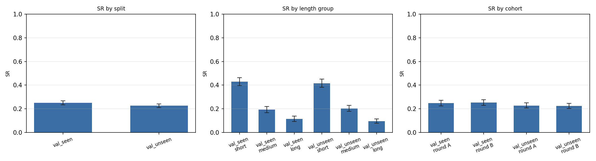
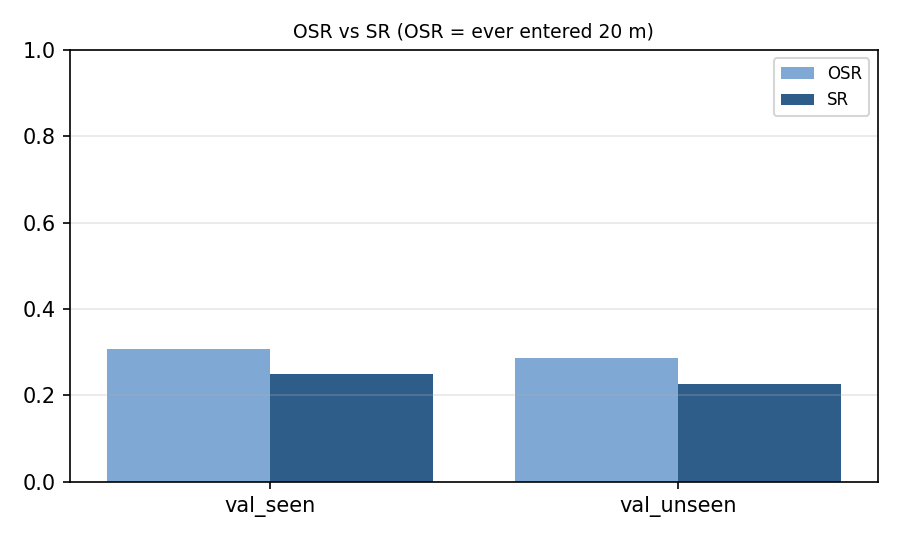
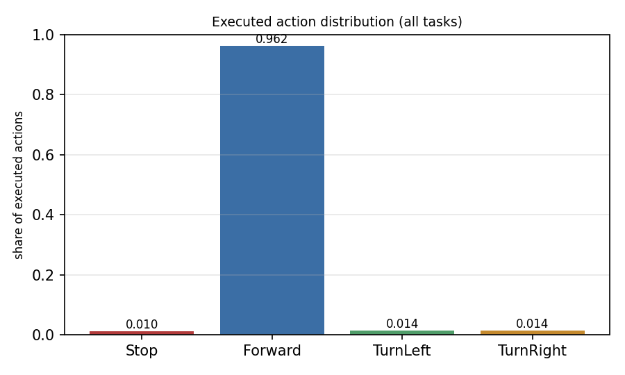
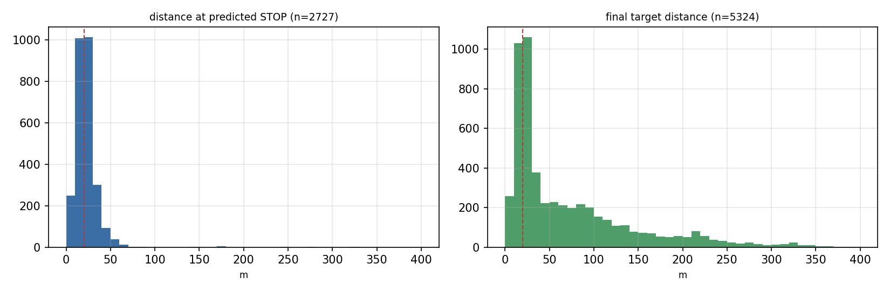
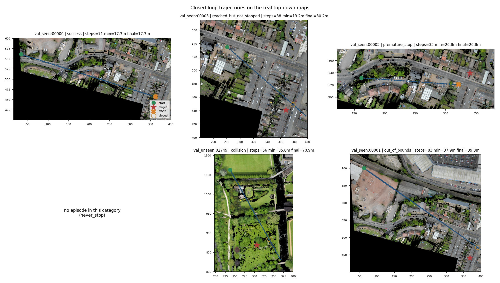

# Stage 06 — Transformer-M（seed 42）闭环导航成功率

## 1. 目的与协议

在固定 50 m 俯视视觉目标导航任务上，用 Stage 05 训练好的 Transformer-M 自己的
`argmax` 动作驱动 UAV，测量闭环成功率 SR。模型不重新训练、不调阈值、不加权；
教师轨迹只提供起点位姿与最终目标位置，不提供中间状态、动作或未来观测。

动作：STOP / Forward 5 m / TurnLeft 30° / TurnRight 30°。
成功判据（三条同时满足）：模型输出 STOP、STOP 时水平距离 ≤ 20 m、最终距离 ≤ 20 m。
最大执行步数 200（来自 03B Train-Seen 的 p99=85、max=127，不把任何教师长度传给模型）。

## 2. 模型

| 项 | 值 |
|---|---|
| checkpoint | `experiments/05_transformer_m_training/runs_v2/seed42/best.pt` |
| SHA-256 | `077f01a4f1a643c3db7ff6a4eb57980a401232bcc4810b05925fb1fceccc0ce2` |
| 选择依据 | Stage 05 Val-Seen Macro-F1 最高（epoch 1，0.7844），**未**按本次闭环结果重选 |
| 参数量 | 4,885,252 |
| 加载方式 | `load_state_dict(..., strict=True)`，`eval()` + `torch.inference_mode()` |

## 3. 输入与推理数据流

| 输入 | 维度 | 来源 |
|---|---|---|
| 当前视觉 | 49×2048 | `heading_crop` 100 m×100 m → 224² → 冻结 ResNet-50 layer4（uint8→GPU 归一化） |
| 目标参考 | 2048 | `north_crop(target, 48 m)` → `embed` → L2，模型侧 FP16 精度往返 |
| 历史视觉 | 16×2048 | 实际执行历史的 pooled 特征，FP16→FP32（与训练缓存同精度） |
| 历史相对位姿 | 16×3 | 当前机头坐标系，仅用实际执行状态 |
| 历史动作 | 16×4 | 实际执行动作 one-hot |
| 历史掩码 | 16 | |
| 全局目标信念 | 12 | `belief_features()`，24 m 候选库，每步用当前位姿重算 |

候选库：`cache_v2/candidates24`（与 Stage 05 缓存索引一致）；编码器：frozen ResNet-50
IMAGENET1K_V2 layer4 FP16。闭环首步决策与训练管线在同一 pose 上的概率差实测
0–0.0002（4 条抽样），说明输入契约一致。

## 4. 任务集合

| 划分 | Short (≤29) | Medium (30–49) | Long (>49) | 合计 |
|---|---|---|---|---|
| val_seen | 870 | 833 | 795 | 2498 |
| val_unseen | 820 | 980 | 1026 | 2826 |
| **合计** | | | | **5324** |

长度分组沿用 03B 由 Train-Seen 确定的边界，未在验证集上重算。每个（划分 × 长度组）
用 seed 20261030 确定性打乱后分成 Round A / Round B 两个互不重叠 cohort，
两者并集覆盖全部任务。未按人工路径质量过滤。

目标图像有效性：`goal_image_invalid` 0 条；目标 patch 有效比例 < 0.5 的 218 条（保留在主结果中，另给子集）。

## 5. 主结果

| 范围 | n | SR | SR 95% CI (Wilson) | OSR | STOP 率 | NE 中位 | 步数均值 | SPL（成功加权） |
|---|---|---|---|---|---|---|---|---|
| 全部 | 5324 | **23.7%** | [22.5, 24.8] | 29.6% | 51.2% | 37.7 m | 50.0 | 0.235 |
| val_seen | 2498 | **24.9%** | [23.3, 26.7] | 30.7% | 53.6% | 32.7 m | 47.4 | 0.248 |
| val_unseen | 2826 | **22.5%** | [21.0, 24.1] | 28.7% | 49.2% | 44.7 m | 52.2 | 0.224 |

### 按长度组

| 划分 | 组 | n | SR | 95% CI | OSR | STOP 率 | NE 中位 | 步数均值 |
|---|---|---|---|---|---|---|---|---|
| val_seen | short | 870 | **42.9%** | [39.6, 46.2] | 51.0% | 79.3% | 21.6 m | 24.0 |
| val_seen | medium | 833 | **19.2%** | [16.7, 22.0] | 24.8% | 48.1% | 40.5 m | 49.9 |
| val_seen | long | 795 | **11.3%** | [9.3, 13.7] | 14.5% | 31.1% | 66.8 m | 70.5 |
| val_unseen | short | 820 | **41.6%** | [38.3, 45.0] | 49.4% | 79.1% | 22.3 m | 27.0 |
| val_unseen | medium | 980 | **20.3%** | [17.9, 22.9] | 26.2% | 45.9% | 52.0 m | 53.1 |
| val_unseen | long | 1026 | **9.5%** | [7.8, 11.4] | 14.6% | 28.3% | 72.7 m | 71.6 |

### 按 cohort

| 划分 | cohort | n | SR | 95% CI | OSR |
|---|---|---|---|---|---|
| val_seen | A | 1250 | **24.7%** | [22.4, 27.2] | 30.6% |
| val_seen | B | 1248 | **25.2%** | [22.8, 27.6] | 30.8% |
| val_unseen | A | 1413 | **22.7%** | [20.6, 25.0] | 29.4% |
| val_unseen | B | 1413 | **22.4%** | [20.3, 24.6] | 28.1% |

### 目标图像有效性子集

| 划分 | 子集 | n | SR | 95% CI |
|---|---|---|---|---|
| val_seen | valid_goal_image | 2498 | **24.9%** | [23.3, 26.7] |
| val_seen | target_valid_ge_0.5 | 2432 | **25.6%** | [23.9, 27.4] |
| val_seen | target_valid_lt_0.5 | 66 | **0.0%** | [0.0, 5.5] |
| val_unseen | valid_goal_image | 2826 | **22.5%** | [21.0, 24.1] |
| val_unseen | target_valid_ge_0.5 | 2674 | **23.8%** | [22.2, 25.5] |
| val_unseen | target_valid_lt_0.5 | 152 | **0.0%** | [0.0, 2.5] |

## 6. 失败模式与动作统计

| 类别 | 条数 | 比例 |
|---|---|---|
| 成功 | 1260 | 23.7% |
| 过早 STOP | 1440 | 27.0% |
| 进入 20 m 但未停 | 318 | 6.0% |
| 到步数上限未停 | 0 | 0.0% |
| 碰撞 | 1 | 0.0% |
| 越界 | 2305 | 43.3% |
| 目标图像无效 | 0 | 0.0% |
| 其他异常 | 0 | 0.0% |

- 碰撞（任意时刻）：0.02%；越界（任意时刻）：48.8%
- 达到 200 步上限：0 条
- NE 中位 37.7 m；停止位置误差中位 20.8 m

四类动作输出：

| 动作 | 次数 | 占比 |
|---|---|---|
| Stop | 2,727 | 1.02% |
| Forward | 256,081 | 96.22% |
| TurnLeft | 3,688 | 1.39% |
| TurnRight | 3,640 | 1.37% |

## 7. 图表

## 8. 运行时间

- 全量闭环耗时：**18.3 分钟**（5324 条，4 worker）
- 平均每条：1.86 秒

## 9. 分析

### 9.1 主结果

全部 5,324 条任务（Val-Seen 2,498 + Val-Unseen 2,826），**SR = 23.7%**，
Wilson 95% CI **[22.5%, 24.8%]**。Val-Seen 24.9%、Val-Unseen 22.5%，两个区间大量重叠，
跨地图泛化没有额外损失。Round A / Round B 的 SR 分别为 24.7% / 25.2%（Seen）与
22.7% / 22.4%（Unseen），相差不超过 1.1 个百分点，结果不是由某一半任务驱动。

长度梯度非常陡：Short 42.9% / 41.6%，Medium 19.2% / 20.3%，Long 11.3% / 9.5%。
任务越长，模型越可能在到达目标前离开地图。

### 9.2 失败发生在哪一步（协议要求的五个判断）

1. **无法找到目标——主导原因。** OSR 只有 29.6%：70.4% 的任务从未进入目标 20 m。
   其中最大的一类是 `out_of_bounds` **2,305 条（43.3%）**：模型沿航向直飞，
   中位 71 步后飞出栅格，出界时最小目标距离中位 47.2 m。长任务越界率 66.4%、
   中任务 47.5%、短任务 13.9%。
2. **找到目标但不停——318 条（6.0%）**：进入过 20 m 却没有成功停止，其中 291 条
   继续飞走（最终距离 24–200 m），27 条是在离开 20 m 后才停下。
3. **过早停止——1,440 条（27.0%）**：停止距离中位 26.0 m（范围 20–65 m），
   STOP 时的平均概率只有 0.489——模型自己也不确定。
4. **动作坍缩——明显**：执行动作中 Forward 占 **96.2%**，TurnLeft 1.4%、
   TurnRight 1.4%、Stop 1.0%；**1,504 条（28.2%）任务全程一次都没有转向**。
   03B 教师的转向占比是 5.9%，模型在闭环里只有它的一半左右。
5. **进入目标附近后继续飞行**：即第 2 类，318 条。

### 9.3 关键：瓶颈不是 STOP，而是到达

- 进入过 20 m 的 **1,578** 条任务中，**1,260 条成功（79.9%）**。
- 成功时停止距离 0.9–20.0 m，中位 14.6 m；成功任务平均 30.5 步。
- 模型在 51.2% 的 episode 中实际输出了 STOP，其中 46.2% 停在 20 m 以内。

也就是说：**一旦接近目标，STOP 基本可用；真正损失 SR 的是"根本没走到目标附近"**。
这与 Stage 05 教师强制诊断给出的"STOP 是瓶颈"（STOP 召回 0.485）并不矛盾——教师强制
只在教师轨迹的状态上评估，看不到模型自己产生长直飞、出界这类分布偏移。

### 9.4 与教师强制指标的差距

| | Stage 05 教师强制（best.pt） | Stage 06 闭环 |
|---|---|---|
| Val-Seen 准确率 / Macro-F1 | 0.934 / 0.762 | — |
| Val-Seen STOP 召回 | 0.485 | 条件成功率 79.9%（进入 20 m 后） |
| 成功率 | — | 24.9%（Seen）/ 22.5%（Unseen） |

差距来自闭环的状态分布：模型自己的动作把 UAV 带到训练分布之外（长直飞、出界），
在这些状态上它既没有教师标签也没有见过。这是 Stage 07 采样/覆盖问题在闭环中的直接体现。

### 9.5 与 300 条先导的对比

先导 300 条（每个划分 × 长度组各 50 条）得到 SR 28.3%，全量是 23.7%；先导的 95% CI
[23.5%, 33.7%] 下界几乎等于全量点估计。原因是先导在每个分组里只取前 25 条 A + 25 条 B，
不是按难度分层随机；**全量结果才是正式结论**，先导只用于确认失败模式与测速。

### 9.6 目标图像有效性：低有效目标全部失败

`goal_image_invalid`（完全无有效像素）0 条。目标 patch 有效比例 < 0.5 的 218 条
（Val-Seen 66、Val-Unseen 152）**没有一条成功（0/218）**：

- 失败构成：越界 137、过早 STOP 44、进入 20 m 未停 37；
- 最小目标距离中位 61.7 m，最终距离中位 151.6 m；
- 集中在地图 `cambridge_block_10`（113 条）、`cambridge_block_2`（39 条）等
  nodata 比例高的区域；目标中心仍有 78.4% 是有效高程像素；
- 对照：有效比例 ≥ 0.5 的子集 SR 为 25.6% / 23.8%。

37 条低有效任务确实进入了 20 m 却没有停下（高有效子集的条件成功率约 80%），
说明目标参考图像的大部分像素失效时，视觉匹配与"已到达"的判断都会退化。
这是相关性证据（低有效目标同时位于数据稀疏区），不是因果实验。没有为提高 SR
静默排除这些任务：它们保留在主结果中，并单独报告。

### 9.7 限制

- 目标图像有效性基于 1 m 高程 validity 掩码；nodata 继续沿用 03B/04 的"可飞"约定，
  该假设未被独立数据验证。
- 低空避障几乎没有被检验：全量只有 **1 次碰撞**（`val_unseen:02749`），
  与 03B 的结论一致——固定 50 m 高度事实上越过几乎所有建筑。
- 闭环里当前观测以 batch=1 编码，训练缓存是 batch=128；实测同一图像的 layer4 特征
  最大差约 0.09（相对 0.2%），首步决策概率差 ≤ 0.0002，不影响结论但应记录。
- `nDTW` 未计算（协议列为可选项）。SPL 按标准定义对全部任务成功加权为 **0.235**；
  只在成功任务内部统计约 0.99——因为模型走直线，路径通常比教师更短，效率项饱和。
- 200 步上限没有被触及：最长 114 步，**0 条**截断，因此不需要 300 步敏感性测试。

### 9.8 下一步建议（未执行）

1. **Stage 07 仍然是 OPEN，且现在有了闭环证据**：教师分布（5.9% 转向、平滑到达）与
   闭环分布（96.2% Forward、28.2% 从不转向、43.3% 出界）严重不匹配。
2. 若要提升 SR，优先级最高的不是调 STOP 阈值，而是让模型在**自己产生的状态**上获得
   监督（DAgger 式教师重标注）或改善转向/覆盖的采样；这需要另开实验，不能回改本阶段结果。
3. STOP 的校准与低有效目标图像可以作为次要项：过早停止 27%、STOP 概率 ~0.49；
   目标 patch 有效比例 < 0.5 的 218 条全失败。
4. `test_unseen` 继续保持封存，本阶段未读取。

