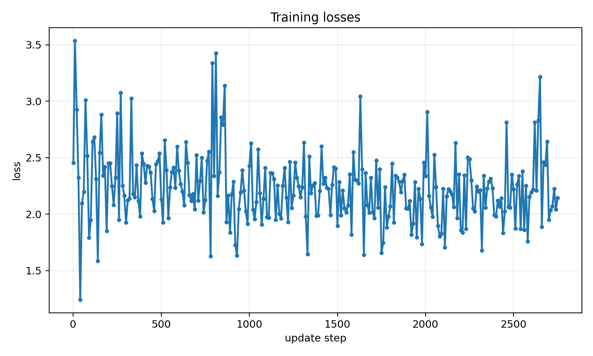
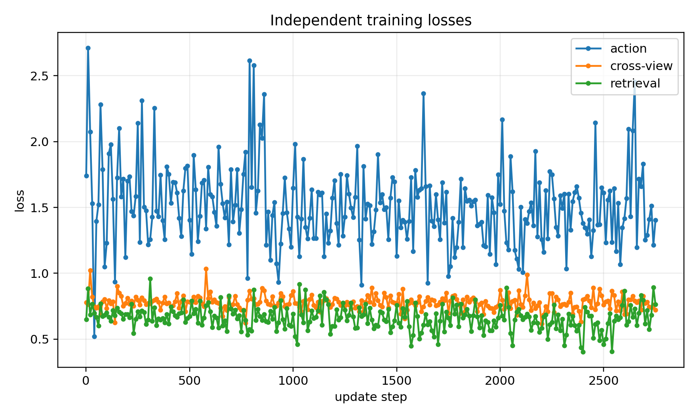
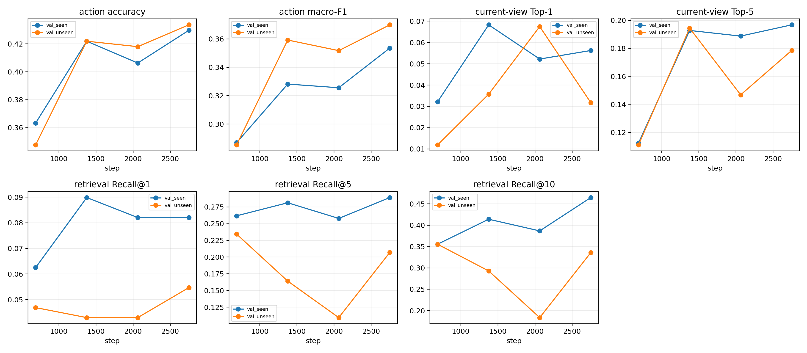
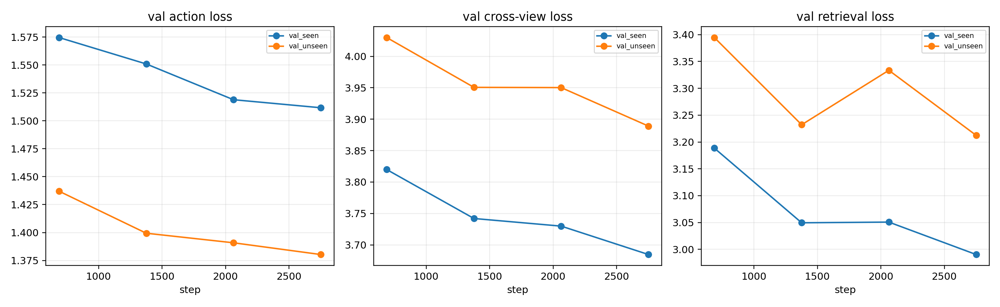
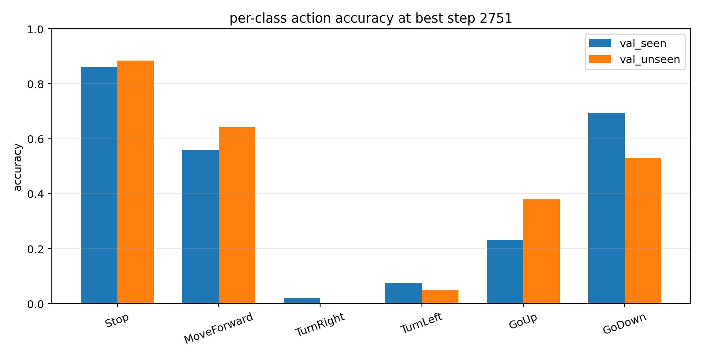

# CityNav 共享视觉编码器预训练报告

- 日期：2026-10-27
- 状态：**已完成并核验**（2751 / 2751 步；未重跑训练）
- 实验目录：`experiments/visual_encoder_citynav/`
- 运行目录：`runs/visual_encoder_citynav/full_20261027_masks_b8/`
- 目标：仅预训练 `VisualTokenEncoder`；不训练 Small/Transformer-M、不生成正式
  MEC Token、不开发 RL。
- 数据：`original_citynav`；Test-Unseen 未读取。

## 0. 结论摘要

上一轮后台任务 `Run final full training with separated masks` 的退出码为 0。
本次没有仅凭退出码下结论，而是核验了完整产物：

- `run_summary.json`：`steps=2751`，`total_steps_planned=2751`，训练完整结束；
- 4 个按 25/50/75/100% 保存的 encoder checkpoint 均存在，另有 `best_encoder.pt`
  和 `encoder_final.pt`；
- `best_encoder.pt` 严格加载成功：3,997,056 / 3,997,056 参数，缺失/多余/形状
  不匹配均为 0；只含 encoder 的 29 个张量，不含动作/跨视角/检索辅助头；
- `best_encoder.pt` 与 `encoder_final.pt` 张量逐元素一致（最大绝对差 0.0）；
- 原始数据快照未变化，`test_unseen_read=false`；
- 7 个契约/无泄漏测试全部通过。

最佳模型（Val-Seen 选择，step 2751）的主要诊断指标：

| 指标 | Val-Seen (256) | Val-Unseen (256) |
|---|---:|---:|
| 动作 accuracy | 0.4297 | 0.4336 |
| 动作 macro-F1 | 0.3536 | 0.3699 |
| 跨视角 Top-1 / Top-5 | 0.0562 / 0.1968 | 0.0317 / 0.1786 |
| 语言→候选 Recall@1 / @5 / @10 | 0.0820 / 0.2891 / 0.4648 | 0.0547 / 0.2070 / 0.3359 |

训练耗时 **2348.937 s（39.15 min）**，GPU 峰值分配显存
**5612.14 MiB（约 5.48 GiB）**。最佳 checkpoint：
`runs/visual_encoder_citynav/full_20261027_masks_b8/best_encoder.pt`，
SHA-256 `322cfa82a06ee926b74541ecde30f7ecd20b15c0a6ddd687647a0cd80d27b23b`。

## 1. 范围与协议

正式训练使用完整 Train-Seen 22,002 条轨迹作为训练池，每条轨迹取一个教师步
样本（单 epoch 覆盖全部轨迹）。Val-Seen 固定 256 条子集用于 Checkpoint 选择；
Val-Unseen 固定 256 条子集只做独立诊断，不参与选模。完整 split 数量与地图
覆盖记录在下方。

模型保持 `VisualTokenEncoder` 架构：336×336 输入、24×24 patch、576×384 token。
优先使用 ToyEnv V8.2 `shared_encoder.pt`；本实验严格加载，实际加载参数比例
1.0000（3,997,056 / 3,997,056），缺失/多余/形状不匹配均为 0。初始化权重
SHA-256：`8ee6194e83ea6c6845f22d0ad271066fb82401d781906da9d4c624ab0a556f56`。

## 2. 数据与标签

| split | 官方轨迹 | 本实验使用 | 地图 |
|---|---:|---:|---:|
| Train-Seen | 22,002 | 22,002（每轨迹 1 个教师步） | 24 |
| Val-Seen | 2,498 | 固定 256 子集 | 23 |
| Val-Unseen | 2,826 | 固定 256 子集，仅诊断 | 4 |
| Test-Unseen | 5,311 | 未读取 | — |

Train manifest 六类动作实际数量（未篡改标签）：

| 动作 | 数量 | 反频率权重 |
|---|---:|---:|
| Stop | 3,667 | 1.0000 |
| MoveForward | 4,242 | 0.8645 |
| TurnRight | 3,653 | 1.0038 |
| TurnLeft | 3,624 | 1.0119 |
| GoUp | 2,466 | 1.4870 |
| GoDown | 4,350 | 0.8430 |

动作权重只用于辅助交叉熵；标签保持教师原始六类动作。

## 3. 三种训练目标

### L_action

当前第一视角视觉 mean+max [768] + 冻结 BERT [768] → 临时动作 MLP → 六类
动作 logits；加权交叉熵。该头只用于给视觉编码器提供导航相关信号，不是
Small/Transformer-M MEC。

### L_xview（当前位姿跨视角）

当前 FPV 视觉全局特征与同一区块固定网格候选视觉 token 做多正样本 InfoNCE。
正样本只由**当前 UAV 位姿** 30 m 半径构造；负样本为同区块 30–120 m 困难
负样本。该损失完全不使用 target 位置。

### L_retrieval（语言→目标候选）

冻结 BERT 语言特征与固定网格候选视觉 token 做多正样本 InfoNCE。正样本由
`target_positions[-1]` 40 m 半径构造，**仅用于训练标签**；验证时只对候选
库排序，不使用 target 坐标/ID 选择输入。该损失与 L_xview 的候选 valid mask、
投影头、指标严格分开。

总损失：

```text
L = L_action + 0.5 * L_xview + 0.5 * L_retrieval
```

Smoke（严格分离 mask，20 步）中 encoder 对三个损失的梯度范数分别为
action 1.69 / xview 1.30 / retrieval 1.71；正式 run 的 step-0 检查为
action 1.46 / xview 1.40 / retrieval 1.88。据此将两个对比损失权重设为 0.5。

## 4. 数据安全与无泄漏

- 原始 CityNav JSON、CityRefer、RGB/TIFF、SensatUrban PLY 均只读；
- 点云 4M downsample、候选库、manifest、BERT 特征、checkpoint、TensorBoard
  只写入 `data_cache/visual_encoder_citynav/`、`data_cache/candidates/` 和
  `runs/visual_encoder_citynav/`；
- 不复制原始数据入仓库，不提交缓存/权重/日志；
- 运行前后原始数据快照一致：135 个文件、48,009,336,063 字节，
  digest `2c784870be858d7d801ee7c12e68c81b44b11cb7`；
- `test_unseen_read=false`，Test-Unseen 未打开；
- 未终止其他 GPU 任务；本实验 GPU 峰值分配显存约 5.48 GiB。

## 5. 正式训练与资源

- 全量 Train-Seen 22,002 条轨迹，单 epoch，batch 8，共 2751 步；
- 早期 batch=32 尝试在第 390 步中断（仅 40 条训练日志、未生成 checkpoint），
  未用于本报告；最终 batch=8 完整跑完，数据池、epoch、损失和动作标签均未减少；
- AdamW，encoder lr 1e-5，辅助头 lr 1e-3，weight decay 1e-4；
- cosine decay，最低为 encoder lr 的 10%；grad clip 1.0；
- 4M 点云 downsample，336 第一视角；候选 96×96，stride 48 m，尺度 32/64/128 m；
- Checkpoint 在 25/50/75/100% 更新步保存，即 step 688 / 1376 / 2063 / 2751。

| 资源项 | 数值 |
|---|---:|
| 训练步数 | 2751 / 2751 |
| 训练样本 | 22,002 |
| 总耗时 | 2348.937 s（39.15 min，约 0.85 s/step 端到端） |
| GPU 峰值分配显存 | 5612.14 MiB（约 5.48 GiB） |
| 逐 step 记录的 allocated | 161.73 MiB（记录时常驻量，不是峰值） |
| FPV 渲染时间 | 0.1780 s/样本（末 100 step 0.1711 s） |
| FPV 有效像素比例 | 0.4024（末 100 step 0.4116） |
| 计算吞吐 | 36.89 样本/s（末 100 step 35.65；不含 DataLoader 渲染等待） |
| 端到端吞吐 | 22,002 / 2348.937 ≈ 9.37 样本/s |
| encoder 梯度范数 | 均值 3.41，末 100 step 3.76，最大 13.31 |
| encoder 参数变化 | L2 1.0670，相对初始化 1.52% |

> 逐 step 的 `step_seconds` 均值约 0.238 s，只覆盖 GPU 侧前向/反向/优化；
> 端到端 0.85 s/step 还包括 DataLoader 中的 FPV 渲染与排队，两者不要混用。

## 6. 三个训练目标的损失

下图是原始逐 step 曲线（batch=8 噪声较大）与独立损失曲线：





| 损失 | 前 100 step 均值 | 后 100 step 均值 | 50-step 滑动均值最小值 | 最后 50-step 均值 |
|---|---:|---:|---:|---:|
| total | 2.3197 | 2.1695 | 2.1179（约 step 1650） | 2.1991 |
| action | 1.5876 | 1.4605 | 1.4006（约 step 1650） | 1.4935 |
| xview | 0.7841 | 0.7724 | 0.7635（约 step 1900） | 0.7728 |
| retrieval | 0.6803 | 0.6456 | 0.6048（约 step 2050） | 0.6383 |

三个目标都在下降；由于 batch=8、单 epoch，单步损失波动明显，后段 50-step
均值相对最低点有小幅回升，但验证集指标继续改善。总损失与分项满足
`total = action + 0.5*xview + 0.5*retrieval`。

## 7. Val-Seen / Val-Unseen 验证

四个 checkpoint 的完整验证结果：

| step | split | action acc | macro-F1 | xview Top-1 | xview Top-5 | R@1 | R@5 | R@10 |
|---:|---|---:|---:|---:|---:|---:|---:|---:|
| 688 | Val-Seen | 0.3633 | 0.2869 | 0.0321 | 0.1124 | 0.0625 | 0.2617 | 0.3555 |
| 688 | Val-Unseen | 0.3477 | 0.2853 | 0.0119 | 0.1111 | 0.0469 | 0.2344 | 0.3555 |
| 1376 | Val-Seen | 0.4219 | 0.3282 | 0.0683 | 0.1928 | 0.0898 | 0.2812 | 0.4141 |
| 1376 | Val-Unseen | 0.4219 | 0.3592 | 0.0357 | 0.1944 | 0.0430 | 0.1641 | 0.2930 |
| 2063 | Val-Seen | 0.4062 | 0.3256 | 0.0522 | 0.1888 | 0.0820 | 0.2578 | 0.3867 |
| 2063 | Val-Unseen | 0.4180 | 0.3518 | 0.0675 | 0.1468 | 0.0430 | 0.1094 | 0.1836 |
| 2751 | Val-Seen | **0.4297** | **0.3536** | 0.0562 | **0.1968** | 0.0820 | **0.2891** | **0.4648** |
| 2751 | Val-Unseen | **0.4336** | **0.3699** | 0.0317 | 0.1786 | **0.0547** | 0.2070 | 0.3359 |

选模分数（Val-Seen）：

| step | 688 | 1376 | 2063 | 2751 |
|---|---:|---:|---:|---:|
| selection score | 0.2029 | 0.2361 | 0.2233 | **0.2450** |

`score = 0.4*macro_F1 + 0.3*xview_top1 + 0.3*retrieval_recall@5`。最佳模型是
step 2751（最终步），Val-Seen 分数 0.2450；Val-Unseen 分数 0.2196。若仅按
Val-Unseen 分数选模，四个 checkpoint 的分数为 0.1880 / 0.2036 / 0.1938 /
0.2196，仍会选 step 2751，因此本结论对选模 split 不敏感。





### 7.1 最佳模型的详细指标（step 2751）

| 指标 | Val-Seen | Val-Unseen |
|---|---:|---:|
| 样本数 | 256 | 256 |
| action loss | 1.5117 | 1.3803 |
| action accuracy | 0.4297 | 0.4336 |
| action macro-F1 | 0.3536 | 0.3699 |
| xview loss | 3.6847 | 3.8890 |
| xview Top-1 / Top-5 | 0.0562 / 0.1968 | 0.0317 / 0.1786 |
| 有当前位姿正样本的帧 | 249 | 252 |
| retrieval loss | 2.9903 | 3.2123 |
| retrieval Recall@1 / @5 / @10 | 0.0820 / 0.2891 / 0.4648 | 0.0547 / 0.2070 / 0.3359 |
| 有目标正样本的帧 | 256 | 256 |

逐类动作 accuracy / F1：

| 动作 | Val-Seen acc | Val-Seen F1 | Val-Unseen acc | Val-Unseen F1 |
|---|---:|---:|---:|---:|
| Stop | 0.8605 | 0.7551 | 0.8837 | 0.8837 |
| MoveForward | 0.5577 | 0.4427 | 0.6415 | 0.4892 |
| TurnRight | 0.0217 | 0.0408 | 0.0000 | 0.0000 |
| TurnLeft | 0.0750 | 0.1250 | 0.0488 | 0.0851 |
| GoUp | 0.2308 | 0.2857 | 0.3793 | 0.3929 |
| GoDown | 0.6939 | 0.4722 | 0.5306 | 0.3688 |



混淆矩阵（行=真实动作，列=预测动作；顺序 Stop / MoveForward / TurnRight /
TurnLeft / GoUp / GoDown）：

```text
Val-Seen
[[37,  0,  0,  1,  0,  5],
 [ 1, 29,  1,  0,  2, 19],
 [ 6, 21,  1,  2,  3, 13],
 [ 7, 12,  0,  3,  2, 16],
 [ 4,  7,  1,  0,  6,  8],
 [ 0, 10,  0,  2,  3, 34]]

Val-Unseen
[[38,  0,  1,  2,  1,  1],
 [ 0, 34,  0,  0,  2, 17],
 [ 4,  9,  0,  1,  7, 20],
 [ 0, 14,  0,  2,  4, 21],
 [ 1,  9,  1,  0, 11,  7],
 [ 0, 20,  0,  1,  2, 26]]
```

预测分布明显偏向 `GoDown`、`MoveForward`、`Stop`：Val-Seen 中三者分别占
37.1% / 30.9% / 21.5%，`TurnRight` 仅 1.2%、`TurnLeft` 仅 3.1%；Val-Unseen
同样只有 0.8% / 2.3%。这是当前辅助动作头最主要的失败模式，不能把
accuracy 接近 0.43 解读为六类动作都已学会。

### 7.2 逐地图结果

- Val-Seen：23 张图、256 帧；
- Val-Unseen：4 张图、256 帧（birmingham_block_5、cambridge_block_2/3/10）；
- 完整逐地图 action accuracy、Top-1/Top-5、Recall@1/5/10、有效像素比例和
  候选库大小见 `results/full_20261027_masks_b8_per_map.csv`。

## 8. Checkpoint 核验

| 文件 | SHA-256 | 说明 |
|---|---|---|
| `best_encoder.pt` | `322cfa82a06ee926b74541ecde30f7ecd20b15c0a6ddd687647a0cd80d27b23b` | Val-Seen 选出的最佳 encoder，15.26 MiB |
| `encoder_final.pt` | `b66862b84cbfc97cf5a91f72a74890319d3a82380a77273ec8b2c4ef17b0f569` | 最终 encoder，与 best 张量逐元素一致 |
| `checkpoints/encoder_step_002751.pt` | `e6221d0e1f349f3a8194c50dae0bba923e3061d6d08fac38300506f7b8a2e90c` | 同一 step 的中间保存文件，张量同样一致 |

- 最佳路径（仓库相对）：
  `runs/visual_encoder_citynav/full_20261027_masks_b8/best_encoder.pt`
- 最佳路径（本机绝对）：
  `/home/ubuntu5/Workspace/citynav-mec-rl/runs/visual_encoder_citynav/full_20261027_masks_b8/best_encoder.pt`
- 严格加载：3,997,056 / 3,997,056 参数，比例 1.0000；29 个张量；缺失/多余/
  形状不匹配均为 0；辅助头 key 为空。
- `best_encoder.pt` 与 `encoder_final.pt` 的最大绝对张量差为 0.0，参数值完全
  相同；两者字节级 SHA 不同（来自 `torch.save` 序列化字节差异），因此等价性
  以逐张量比较为准，发布标识使用 `best_encoder.pt` 的 SHA-256。
- 相对初始化权重，encoder 参数变化 L2 = 1.0670，相对变化 1.52%。
- 4 个 checkpoint 文件均存在且可加载：step 688 / 1376 / 2063 / 2751。

核验 JSON：`results/full_20261027_masks_b8_checkpoint_verification.json`；
复现命令：

```bash
/home/ubuntu5/miniconda3/envs/AirVLN/bin/python \
  experiments/visual_encoder_citynav/verify_checkpoint.py \
  --run-name full_20261027_masks_b8
```

## 9. 产物清单

`results/`：

- `full_20261027_masks_b8_train_metrics.csv`：逐 step 总损失、三个分项损失、
  梯度、学习率、参数变化、渲染/显存/吞吐；
- `full_20261027_masks_b8_loss_components.csv`：三个训练目标的精简损失曲线；
- `full_20261027_masks_b8_validation_summary.csv`：四个 step × 两个 split 的
  action/cross-view/retrieval 指标；
- `full_20261027_masks_b8_per_map.csv`：最佳模型的逐地图指标；
- `full_20261027_masks_b8_analysis.json`：汇总、资源、文件索引；
- `full_20261027_masks_b8_best_metrics.json`；
- `full_20261027_masks_b8_val_history.json`；
- `full_20261027_masks_b8_gradient_checks.json`；
- `full_20261027_masks_b8_summary.json`；
- `full_20261027_masks_b8_checkpoint_verification.json`。

`figures/`（12 张，220 dpi）：

`loss_total`、`loss_components`、`encoder_grad_norm`、`encoder_param_delta`、
`lr_encoder`、`render_seconds`、`valid_pixel_ratio`、`throughput`、
`gpu_memory`、`validation`、`validation_losses`、`per_class`。

`runs/visual_encoder_citynav/full_20261027_masks_b8/` 保留 best/final/四个
step checkpoint、TensorBoard 和原始训练日志；这些大文件在 `.gitignore` 中，
**不提交**。

## 10. 限制与下一步

- 本次为单 epoch 短训练；Val 指标是辅助动作/匹配诊断，**不是 MEC 导航
  成功率**；
- 4M 点云 downsample 有明显空洞，FPV 有效像素比例约 0.40；空洞会限制视觉
  编码器质量，不能靠目标标签或修改原始数据规避；
- 动作头对 TurnRight/TurnLeft 几乎不预测，六类动作严重不均衡；后续若继续
  该编码器，应优先解决侧向动作监督，而不是只看总体 accuracy；
- 跨视角 Top-1 与检索绝对指标仍低；Val-Unseen 的检索 R@5/R@10 在训练后段
  没有单调改善（R@5 最高出现在 step 688），提示 4 图/256 样本的 unseen
  诊断存在较大方差，也存在领域差距；
- 不训练 Small/Transformer-M，不生成正式 MEC Token，不开发 RL；Test-Unseen
  继续封存；
- 若继续本方向，优先顺序是：更高点云密度/表面重建 → 稳定的侧向动作监督 →
  相同协议下重复 seed；在未见稳定 Val-Seen 改善前不扩大模型或引入新目标。

## 11. 复现与验证命令

训练（本次未重跑，仅记录）：

```bash
/home/ubuntu5/miniconda3/envs/AirVLN/bin/python \
  experiments/visual_encoder_citynav/train.py \
  --run-name full_20261027_masks_b8 --device cuda --num-workers 2 \
  --val-samples 256 --batch-size 8
```

分析与核验：

```bash
/home/ubuntu5/miniconda3/envs/AirVLN/bin/python \
  experiments/visual_encoder_citynav/analyze.py \
  --run-name full_20261027_masks_b8

/home/ubuntu5/miniconda3/envs/AirVLN/bin/python \
  experiments/visual_encoder_citynav/verify_checkpoint.py \
  --run-name full_20261027_masks_b8

/home/ubuntu5/miniconda3/envs/AirVLN/bin/python -m pytest -q \
  experiments/visual_encoder_citynav/tests
```

契约测试结果：7 passed。
